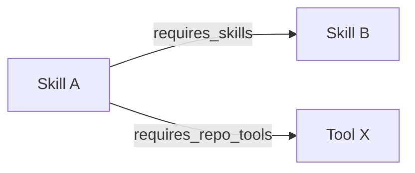
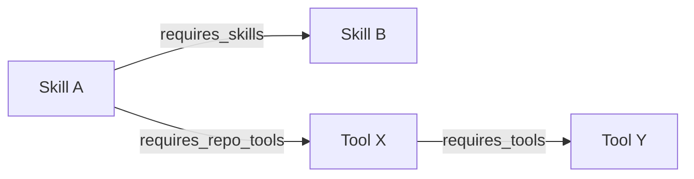

# スキルとツールの関係グラフ

スキルや `tools/` 配下のCLIを変えるとき、関連して直すべきスキル・ツールをグラフから列挙する。スキル起点の辺は各 `SKILL.md` の `meta:`、ツール→ツールは [`repo-tools.yaml`](../../repo-tools.yaml) の `requires_tools`。変更時の手順は [changing-skills-and-tools](../../meta-plugins/skills/changing-skills-and-tools/SKILL.md) がスクリプト実行とこの文書への誘導だけを持つ。コミット直前の確認は [committing](../../meta-plugins/skills/committing/SKILL.md)。

## スキル起点の辺

辺の**定義**は [`meta_field.yaml`](../../meta_field.yaml)（[skill-meta-fields](/repo-wide/skill-meta-fields.md)）がSSOT。辺の**実体**は各 `SKILL.md` の `meta:` に書かれている。



| 方向            | 宣言場所                   | 辿り方                                                                                                 | 例                                  |
| --------------- | -------------------------- | ------------------------------------------------------------------------------------------------------ | ----------------------------------- |
| スキル → スキル | `meta.requires_skills`     | そのスキルの frontmatter を読む                                                                        | `tav-digest` → `tav-cli`, `aim-cli` |
| スキル → ツール | `meta.requires_repo_tools` | 同上。値は [`repo-tools.yaml`](../../repo-tools.yaml) のキーまたは `path`                              | `aim-cli` → `aim`                   |
| ツール → スキル | （宣言なし、逆引き）       | 全 `SKILL.md` の `requires_repo_tools` / `requires_install` をスキャンし、当該ツールを指すものを集める | `aim` ← `aim-cli`, `aim-lib`        |

ツール→スキルの逆引きは、辺を二重に持たなくてよい。スキル側の `requires_repo_tools`（およびツール名がそちらに無いときの `requires_install`）が唯一の正向で、逆は索引である。コンパニオンスキル（使い方スキル）とその他の消費者の区別は [tool-companion-skills](/repo-wide/tool-companion-skills.md) の置き場所・責務で人間が判断する。ツール側に「これが使い方スキル」と書くフィールドは必須にしない。

## なぜツール側に辺を置くか

ツールが他のリポジトリ内ツールに依存していても、スキルグラフからは取れない。依存は次のような場所に散在していた。

- `pyproject.toml` の workspace 依存（`aim-summarize` の `dependencies = ["aim-cli"]`）
- グループフォルダ（`tools/aim-use/` は `tools/aim` を使うラッパー群、という説明が [tools-directory-layout](/repo-wide/tools-directory-layout.md) にあるだけ）
- README / AGENTS.md の散文
- スキル経由の推論（後述のとおり損失がある）

スキル経由で補うのも不十分である。

- `aim-summarize` スキルの `requires_repo_tools` は `git` であり、`aim` でも `aim-summarize` でもない。ツール同士のライブラリ依存はスキルメタに現れていない
- `tav-digest` / `ms-digest` は自前のソースを持たないオーケストレーションスキルで `requires_repo_tools: none`。`aim` を変えても、ツール逆引きではこれらのスキルに届かない（スキル→スキルの `requires_skills` を辿れば届く）
- 2つのツールが同じスキルから参照されていても、それらが互いに依存していることにはならない

**ツール同士の関係はスキルグラフから推論しない。ツール側に正向の辺を置く。**

## グラフ



逆引きはすべて正向の索引とする（同じ事実を2箇所に手で書かない）。

| 方向            | 正向のSSOT                                                     | 逆引き             |
| --------------- | -------------------------------------------------------------- | ------------------ |
| スキル → スキル | 各 `SKILL.md` の `requires_skills`                             | 全スキルをスキャン |
| スキル → ツール | 各 `SKILL.md` の `requires_repo_tools`                         | 全スキルをスキャン |
| ツール → ツール | [`repo-tools.yaml`](../../repo-tools.yaml) の `requires_tools` | 同ファイル内の索引 |

`meta_field.yaml` はスキル側フィールドの意味のSSOTのまま。ツール側の辺はスキル frontmatter に足さず、ツール登録のSSOTである `repo-tools.yaml` に足す。理由は次のとおり。

- スキルを持たないツール同士の依存（ラッパー、ライブラリ専用パッケージ）を落とさない
- [repo-ssot-pattern](/repo-wide/repo-ssot-pattern.md) どおり、ツールの事実はツール用SSOTに置く
- 既存の `check_skill_repo_tools.py` が既に `repo-tools.yaml` を読んでいるので、チェックを足す先が同じファイルになる

## ツール→ツールの宣言

`repo-tools.yaml` の各エントリに `requires_tools` を足す。キーは同ファイルのツール名（`aim` / `tav` / `aim-summarize` 等）。値は関係の種類。

```yaml
tools:
  aim:
    path: tools/aim
    install: "uv tool install --editable tools/aim"
    release: true
    # requires_tools を省略するか、空にする = リポジトリ内ツールへは依存しない

  aim-summarize:
    path: tools/aim-use/aim-summarize
    install: "uv tool install --editable tools/aim-use/aim-summarize"
    requires_tools:
      aim: library
```

### 関係の種類

| `kind`       | 意味                                                                          | 上流を変えたとき下流を見るか                                                   |
| ------------ | ----------------------------------------------------------------------------- | ------------------------------------------------------------------------------ |
| `library`    | Python import / workspace パッケージ依存                                      | **必須。** 公開関数・型・例外・デフォルトモデルが変わったら下流を直す          |
| `subprocess` | 他CLIをプロセスとして呼ぶ                                                     | **必須。** フラグ・終了コード・stdout契約が変わったら下流を直す                |
| `family`     | 実行時依存はないが、規約を共有する（`.env` の置き場、モデル略記など） | **確認する。** 規約ドキュメントや共通フラグを変えたら下流のREADME/スキルを見る |

`kind` を分けるのは、変更の爆破半径を「壊れる」と「揃えておきたい」で切り分けるため。`family` だけを `requires_tools` に書くのは、共有規約の変更が実際に波及するときだけにする。ディレクトリが隣同士というだけで辺を張らない。

### 識別子

スキルの `requires_repo_tools` は、理想では `repo-tools.yaml` のキーに揃える（`aim` であり `tools/aim` でもパッケージ名 `aim-cli` でもない）。現状は `aim` / `tools/aim` / `git`（リポジトリ外）が混在している。一括正規化はこのグラフの対象外で、クエリ側がキー / `path` / 外部名を解決する。

リポジトリ外の依存（`git`、PyPIパッケージ、AIコーディングツール組み込みの `Read` 等）はツール→ツールの辺にしない。スキル側は従来どおり `requires_install` / `dependencies` / `requires_env` で表す。

### 登録対象

`repo-tools.yaml` には、少なくとも1スキルから参照されているツールに加え、**他ツールから依存される／他ツールに依存する first-class ツール**を載せる。載せないものは次に限る。

- `tools/internal/**` — リポジトリ保守用
- スキルも他ツールも参照しない実験・単発スクリプト

## 変更時に見る場所

変更の種類ごとに次を辿る。対象が決まったら `just --justfile tools/internal/justfile skill-tool-impact <対象>` で下流を列挙し、この節に従って直す。手順スキルは [changing-skills-and-tools](../../meta-plugins/skills/changing-skills-and-tools/SKILL.md)。コミット直前の確認は [committing](../../meta-plugins/skills/committing/SKILL.md)。スキル本文へ同じチェックリストを複製しない。

### スキルを変える

1. その `SKILL.md`（本文・`meta:`）。`meta.version` 以外を変えたらバージョンバンプ（[skill-md-commits](/repo-wide/skill-md-commits.md)）
2. **下流スキル** — このスキル名を `requires_skills` に書いているスキル（逆引き）
3. このスキルがコンパニオンなら、対象ツールの README / `--help` / `--ai-help`。使い方FBは `skill-tools --fb`（[tool-companion-skills](/repo-wide/tool-companion-skills.md)）。スキルは使い方だけを持ち、セットアップはツールREADME側
4. `requires_repo_tools` / `requires_install` を変えたら `repo-tools.yaml` にそのツールが既にあることを確認する（lefthook チェック）

フィールド定義そのものを増やす・意味を変えるときだけ [`meta_field.yaml`](../../meta_field.yaml) を先に直す。個別スキルの依存を足す作業で `meta_field.yaml` は触らない。

### ツールを変える

1. ツール本体（`tools/<name>/` の実装、README、`AGENTS.md` チェーン、マニフェストversion、公開CLIの`--version`契約）
2. **下流スキル** — `requires_repo_tools` または `requires_install` がそのツールを指すスキル（逆引き）。コンパニオンがあれば使い方の判断基準（モデル表、フラグの意味論）を同期する
3. **下流ツール** — `repo-tools.yaml` の `requires_tools` がこのツールを指すエントリ
   - `library` / `subprocess`: 契約が変わっていれば必須
   - `family`: 共有規約が変わっていれば確認
4. 下流ツールがさらにスキルを持つなら、そのスキルも 2 と同じ（ツール→ツール→スキル）
5. `path` / `install` / `release` を変えたら `repo-tools.yaml` 自体。`release: true` なら [tools-site](../../tools-site/) とタグ+Release（[repo-tools-config](/repo-wide/repo-tools-config.md)）
6. Python パッケージなら workspace の `pyproject.toml`（[uv-workspace](/repo-wide/uv-workspace.md)）。`requires_tools: library` と workspace 依存は同じ事実の二表現なので、lefthook が一致を検査する

### やらないこと

- スキルの `requires_skills` だけを見て「これらのツールは互いに依存している」とみなす（digest スキルが複数ツールを組むだけのことがある）
- ツール側の辺を各 `SKILL.md` にコピーする（ドリフトする）
- すべての `tools/` 配下ディレクトリを機械的に `requires_tools` で全結合する

## 既存の実例

| 上流             | 下流                                                | `kind`                  | 辿り方                                                                                                                                   |
| ---------------- | --------------------------------------------------- | ----------------------- | ---------------------------------------------------------------------------------------------------------------------------------------- |
| `aim`            | `aim-summarize`                                     | `library`               | `repo-tools.yaml` の `requires_tools`（実体は `tools/aim-use/aim-summarize/pyproject.toml` の workspace 依存）。スキルメタからは取れない |
| `aim`            | `aim-cli` / `aim-lib` スキル                        | （ツール→スキル逆引き） | `requires_repo_tools: aim` / `tools/aim`                                                                                                 |
| `aim-cli` スキル | `aim-summarize` / `tav-digest` / `ms-digest` スキル | （スキル→スキル）       | 各スキルの `requires_skills`                                                                                                             |
| `tav`            | `tav-cli` / `tav-lib` スキル                        | （ツール→スキル逆引き） | `requires_repo_tools`                                                                                                                    |
| `tav-cli` スキル | `tav-digest` / `tav-lit` スキル                     | （スキル→スキル）       | `requires_skills`。`tav-lit` は実行時に `tav` へ依存しないので、ツール→ツールの辺は張らない                                              |

`tav-digest` はツールではない。`tav` と `aim` のツール同士に辺は無い。`aim` の CLI 契約を変えたときに digest スキルへ届ける経路は、`aim` →（逆引き）→ `aim-cli` スキル →（逆引き）→ `tav-digest` スキル、という **ツール→スキル→スキル** である。ツール→ツールを足しても、この経路は残す。

## 実装済みの最小セット

グラフとして閉じる実装は次だけ。サイトや生成物は先回りして増やさない。

1. `repo-tools.yaml` の `requires_tools`（キーは既存ツール名、値は `library` / `subprocess` / `family`）
2. 参照先が同ファイルに無い・種類が不正、なら失敗する検査（`tools/internal/skill/check/check_repo_tool_relations.py`）。lefthook の check 段（`tools/internal precommit check`）が既存の `check_skill_repo_tools.py` と一緒に走る。`tools/**/pyproject.toml` も glob に含む
3. `library` の辺は、対象が Python パッケージなら `pyproject.toml` の workspace 依存と一致することを検査する
4. 変更対象から下流を列挙するクエリ（`just --justfile tools/internal/justfile skill-tool-impact`）。lefthook には繋がない。コミットにスキル/`tools/` が含まれるときは [committing](../../meta-plugins/skills/committing/SKILL.md) がエージェントに叩かせる
5. 変更時の手順はこの文書の「変更時に見る場所」を正本にする。エージェント向けの起動は [changing-skills-and-tools](../../meta-plugins/skills/changing-skills-and-tools/SKILL.md)。コミット直前も同じ手順を [committing](../../meta-plugins/skills/committing/SKILL.md) から辿る

skills-site のリンク化や tools-site への下流表示は、辺が安定してからでよい。

## 関連

- [skill-meta-fields](/repo-wide/skill-meta-fields.md) — スキル側の辺（`requires_skills` / `requires_repo_tools` 等）のフィールド定義
- [repo-tools-config](/repo-wide/repo-tools-config.md) — `repo-tools.yaml`（スキルが参照してよいツールの登録と、ツール同士の `requires_tools`）
- [tool-companion-skills](/repo-wide/tool-companion-skills.md) — ツールに使い方スキルを併設するかの判断。ツール→スキルの「正」のコンパニオン
- [tools-directory-layout](/repo-wide/tools-directory-layout.md) — ツールディレクトリとグループ化。フォルダ隣接は `requires_tools` の代わりにしない
- [repo-ssot-pattern](/repo-wide/repo-ssot-pattern.md) — ツールの辺を `repo-tools.yaml` に置く理由
- [skill-md-commits](/repo-wide/skill-md-commits.md) — スキルを変えたあとのコミット時フック
- [changing-skills-and-tools](../../meta-plugins/skills/changing-skills-and-tools/SKILL.md) — 変更時に影響範囲スクリプトを叩く手順
- [committing](../../meta-plugins/skills/committing/SKILL.md) — コミット時に lefthook がカバーしない下流確認

## このドキュメントの位置づけ

`meta-plugins/` はこのリポジトリ自身のメンテナンス用であり、ユーザー向けプラグインではない。既存方針に従い、この内容を `ai-tools.yaml` へ登録しないこと。詳細は [ai-tools-config](/repo-wide/ai-tools-config.md) 参照。
